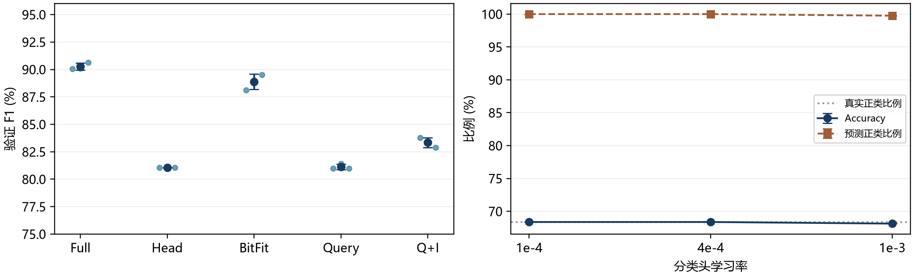
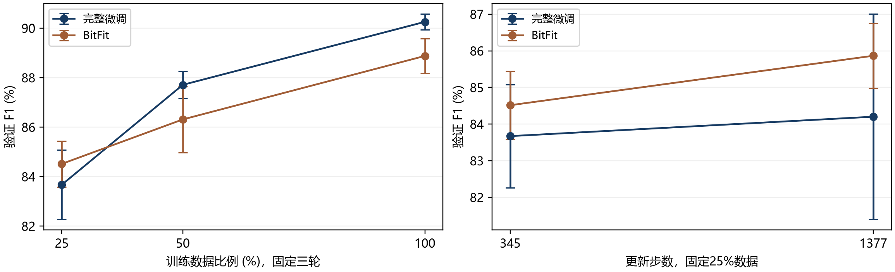
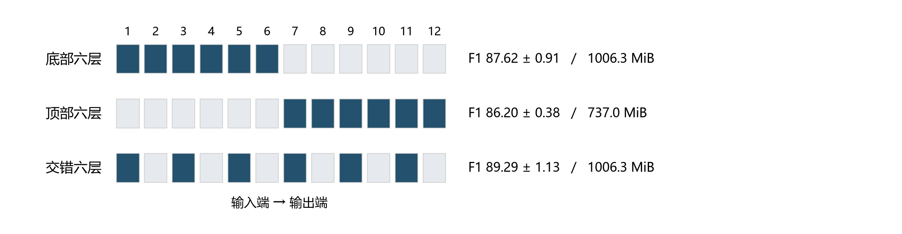

# BitFit 在 MRPC 上的复现与消融实验

G3 · P06 · 自然语言处理项目实践 2026。固定 MRPC 与 BERT-base-uncased，比较任务效果、可训练参数、峰值显存和训练耗时，并用首步梯度与训练前后参数差异核验实际更新。

本仓库现包含 **48 次新增本机正式运行**（21 + 18 + 9），以及独立保留的原始 **12 次历史实验**。每个设置使用种子 **17、42、73**；不同软件环境的结果不混算。`smoke`预检和单批次计算图检查不计入正式训练数。

[最新中期报告 Markdown](reports/BitFit中期报告_位置消融版.md) · [PDF](reports/BitFit中期报告_位置消融版.pdf) · [Word](reports/BitFit中期报告_位置消融版.docx) · [完整输入与预测样例](examples/README.md)

## 实验与证据索引

| 内容 | 正式运行数 | 入口与记录 |
|---|---:|---|
| 主对照、query/intermediate子集、分类头学习率 | 21 | [run_suite.py](run_suite.py) · [results_local](results_local) · [说明](docs/README_LOCAL.md) |
| 25%/50%数据与25%等1377步控制 | 18 | [run_data_suite.py](run_data_suite.py) · [results_data](results_data) · [说明](docs/README_DATA.md) |
| 同参数量的底部/顶部/交错六层偏置 | 9 | [run_layer_suite.py](run_layer_suite.py) · [results_layers](results_layers) · [说明](docs/README_LAYERS.md) |
| 原仓库四组对照 | 12 | [train.py](train.py) · [results](results) · [原中期记录](docs/midterm.md) · [原README](docs/README_original.md) |

**原始 `train.py` 和 `results/` 保留。** 新增主对照使用 [train_local.py](train_local.py)，其内容与本机实际执行代码的SHA-256一致；这是文件发布时的重命名。数据量及位置消融分别使用`train_data.py`、`train_layers.py`。[代码映射、原调度脚本与差异](docs/provenance/publishing.md)记录了发布路径调整。

每个`results_*/种子/配置/`包含`metrics.json`（配置、逐轮loss、分数、显存、秒数、环境与初始化哈希）、`predictions.jsonl`（408条验证ID、金标、预测、p1）、`audit.json`（全部201个参数张量的首步梯度、变化元素数和最大差异）。每组目录另含`plan.json`、`environment.json`、`suite.log`、汇总CSV、`aggregate.json`和`verification.json`。

[48次运行统一CSV](all_local_runs.csv) · [统一核验结论](verification_all.json) · [本次发布前复核日志](docs/verification_publish.log) · [16个样例JSONL](examples/cases.jsonl)

样例固定种子17，追踪10个历史错误/边界例，另加入3个“顶部错而交错对”和3个“交错错而底部对”的案例，均保留8组输出及来源路径。这是诊断性选择，不代表随机抽样错误率。

## 主对照与偏置子集

下表为**本机**三种子均值±样本标准差，F1与Accuracy单位为%。参数量含完整分类头；显存和耗时列为三次均值。

| 方法 | F1 % | Accuracy % | 可训练参数 | 峰值 MiB | 训练秒数 |
|---|---:|---:|---:|---:|---:|
| 完整微调 | 90.26 ± 0.32 | 86.19 ± 0.28 | 109,483,778 | 2155.3 | 104.6 |
| 仅分类头 | 81.05 ± 0.00 | 68.14 ± 0.00 | 1,538 | 479.4 | 19.2 |
| BitFit | 88.88 ± 0.70 | 84.15 ± 1.11 | 104,450 | 1013.7 | 43.0 |
| query bias | 81.13 ± 0.24 | 70.02 ± 0.14 | 10,754 | 998.7 | 37.0 |
| query + intermediate bias | 83.34 ± 0.45 | 74.92 ± 0.62 | 47,618 | 999.6 | 38.1 |

BitFit以约0.0954%的可训练参数取得88.88的F1，仍低于完整微调的90.26。query+intermediate比query提高2.21个百分点，但本次三轮预算下仍未达到全bias效果。子集均冻结pooler bias，与作者部分偏置实现不同。



分类头学习率探索中，1e-4和4e-4的三个种子均将全部验证样本判为正类，F1为81.22、Accuracy为68.38；与全部判正的无训练多数类基线相同。默认1e-3预测99.75%为正类。降低学习率没有解决退化，不能只凭约81%的F1判断分类有效。

## 训练数据量与优化预算

[子集ID及源位置](data/subsets)由[make_subsets.py](make_subsets.py)按标签分层、抽样种子20261117固定生成，并保持嵌套。两方法及三个训练种子共享同一子集。三轮曲线同时改变唯一数据量和更新步数，因此另加25%子集精确1377步的控制。100%行复用上一轮全量记录，不重复计作新训练。

| 数据 / 预算 | 样本数 | 更新步数 | Full F1 % | BitFit F1 % |
|---|---:|---:|---:|---:|
| 25% / 3轮 | 917 | 345 | 83.67 ± 1.41 | 84.51 ± 0.93 |
| 50% / 3轮 | 1834 | 690 | 87.71 ± 0.55 | 86.31 ± 1.33 |
| 100% / 3轮 | 3668 | 1377 | 90.26 ± 0.32 | 88.88 ± 0.70 |
| 25% / 等步数 | 917 | 1377 | 84.20 ± 2.81 | 85.87 ± 0.89 |



25%数据等步数时，BitFit均值高于Full约1.66个百分点，但Full标准差较大，且延长训练后并非所有种子都提升。每个比例只使用一份固定子集，标准差不包含不同数据抽样的波动。25%等步数处理10983个样本实例，全量三轮为11004；相同步数不等于相同唯一数据或完全相同样本曝光量。

## 等参数量的层位置消融

三组只改变哪六层的bias开放，均为**52,226个可训练参数、50个张量**；分类头完整训练，embedding与pooler全部冻结。表中层号从1计，代码中的层索引从0计。

| 位置 | 选中层 | F1 % | Accuracy % | 峰值 MiB | 训练秒数 |
|---|---|---:|---:|---:|---:|
| 底部六层 | 1–6 | 87.62 ± 0.91 | 81.86 ± 1.49 | 1006.3 | 38.8 |
| 顶部六层 | 7–12 | 86.20 ± 0.38 | 78.92 ± 0.49 | 737.0 | 27.7 |
| 交错六层 | 1、3、5、7、9、11 | 89.29 ± 1.13 | 84.48 ± 1.84 | 1006.3 | 36.5 |



相同参数量并不保证相同效果和训练成本。顶部相对底部显存减少约26.8%，但F1较低；交错组均值最高，不能据三个种子宣称稳定优于全bias BitFit。

[单批次计算图检查](results_layers/graph_probe.json)由[inspect_layer_graph.py](inspect_layer_graph.py)在正式计时外执行：顶部组前6层输出没有`grad_fn`，另外两组12层输出都有。冻结层仍执行前向，且可能传递梯度；这支持计算图覆盖范围的解释，不是逐算子显存分解。只测试一种交错集合，也不能独立拆分平均深度与分散程度的作用。

## 复现与核验

所有新增实验使用Windows、RTX4060 Laptop 8GB、驱动560.94、Python3.13.5、PyTorch2.6.0+cu124、Transformers4.46.0；完整版本快照见[requirements-local.txt](requirements-local.txt)和各组`environment.json`。原12次使用另一套软件环境，见存档README。

固定模型`google-bert/bert-base-uncased` revision `86b5e0934494bd15c9632b12f734a8a67f723594`；MRPC数据revision `bcdcba79d07bc864c1c254ccfcedcce55bcc9a8c`。训练3668条、验证408条、最大长度128、batch8、BF16自动混合精度与FP32参数、eager attention、AdamW、weight decay0、梯度范数上限1、无warmup、线性衰减到0。Full使用2e-5，其余主配置1e-3；分类头探索另有1e-4/4e-4。固定最后一步评价，不按验证分数挑checkpoint。

建议在独立Python3.13环境中安装核心依赖；`requirements-local.txt`是实际环境快照，包含并非训练必需的其他包。预训练权重、`.cache`和临时环境未上传；prepare.py按[原资源哈希](data/resources.json)下载并核对模型、分词器和数据。

```powershell
python -m pip install torch==2.6.0 --index-url https://download.pytorch.org/whl/cu124
python -m pip install transformers==4.46.0 numpy==2.3.3 tokenizers==0.20.3 safetensors==0.7.0 pyarrow==24.0.0
# 下载受限时可选择镜像，但输入仍必须通过同一SHA-256校验
# $env:HF_ENDPOINT = "https://hf-mirror.com"
python -s prepare.py
# 已有结果的独立复核，无需重新训练或GPU
python -s verify_all.py
```

完整训练顺序：

```powershell
# 21次主对照和敏感性实验
python -s train_local.py --smoke
python -s run_suite.py
# 18次数据量与等步数实验
python -s make_subsets.py
python -s train_data.py --mode bitfit --percent 25 --smoke
python -s run_data_suite.py
# 9次层位置消融及独立计算图检查
python -s train_layers.py --smoke
python -s run_layer_suite.py
python -s inspect_layer_graph.py
# 统一复核并重新生成48次汇总
python -s verify_all.py
```

仓库已经包含完成的结果，调度脚本会跳过已有`metrics.json`；它们仍可能更新环境/计划文件。需要重新训练时，在另一份本地副本中先备份并移走对应结果子目录，再运行，避免覆盖原证据。数据量和位置消融的核验会引用主对照初始化，因此应按上述顺序完成。48次纯训练累计约1935秒（32.3分钟），不含准备、初始化、验证、写盘和参数差异审计；当前硬件的总复现时间会更长。

单次示例：

```powershell
python -s train_local.py --mode bitfit --seed 42
python -s train_data.py --mode bitfit --percent 25 --budget steps --seed 17
python -s train_layers.py --mode top --seed 17
```

## 解释边界与资料来源

这些比较均在已观察过的MRPC验证集上进行，为探索性实验；测试集使用0次。只有三个训练种子，没有显著性或跨任务结论；数据量扩展未评估多个独立抽样。

峰值显存为PyTorch `max_memory_allocated` 的MiB，包含常驻GPU的完整分词后训练/验证缓存；不是整卡占用或reserved显存。计时含训练与首步梯度审计，起止同步CUDA；不含下载、验证、写盘和训练后差异审计。不同训练层的位置会改变反向图覆盖范围，数据量减少也不代表输入缓存按比例缩小。

代码、执行和报告整理使用了AI辅助；所有新增结论对应原始预测及审计文件，仍需成员本人审阅。[报告](reports/BitFit中期报告_位置消融版.md)包含成员分工、完整参考文献、10个完整案例及局限。

- [BitFit论文](https://aclanthology.org/2022.acl-short.1/)
- [作者参考实现及固定提交](https://github.com/benzakenelad/BitFit/tree/7ead19a8350a01d5701f9e2df896a1c5b42c3723)
- [固定MRPC版本](https://huggingface.co/datasets/nyu-mll/glue/tree/bcdcba79d07bc864c1c254ccfcedcce55bcc9a8c/mrpc)
- [固定BERT权重版本](https://huggingface.co/google-bert/bert-base-uncased/tree/86b5e0934494bd15c9632b12f734a8a67f723594)
- [PyTorch 2.6 Autograd机制](https://docs.pytorch.org/docs/2.6/notes/autograd.html)
