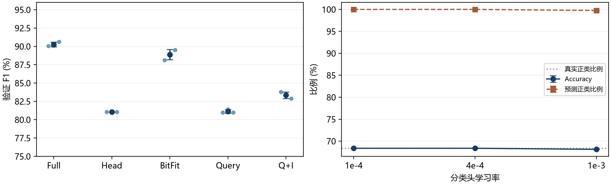
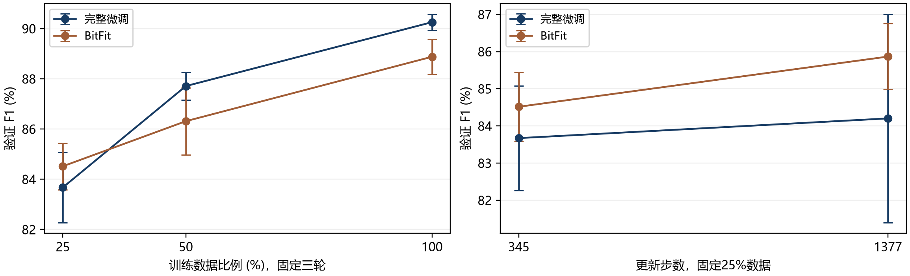

# 论文部分复现报告模板

课程：自然语言处理项目实践 2026

题目：BitFit 在 MRPC 上的参数效率与 query 偏置子集消融

小组编号：G3　论文编号：P06　四名成员：高兴 1120230531；蓝子钧 1120231937；葛炫毅 1120231079；石笑屹 1120232597

复现类型：缩规模复现

## 1 论文来源与复现问题

论文作者为 Elad Ben Zaken、Yoav Goldberg、Shauli Ravfogel，标题为 BitFit: Simple Parameter-efficient Fine-tuning for Transformer-based Masked Language-models，ACL 2022 Short Papers，1–9页[1]。论文：https://aclanthology.org/2022.acl-short.1/；作者代码：https://github.com/benzakenelad/BitFit，参考提交 7ead19a8350a01d5701f9e2df896a1c5b42c3723[2]。

原文实验定位：第3节定义方法，第4节表2的BB行与表3的MRPC列报告BERT-base验证结果；附录A.2和表6列出优化配置。本组关注偏置适配能否在大幅减少可训练参数的同时保留句对分类效果，以及哪些偏置子集足以支撑任务。输入为英文句对，输出为是否语义等价，正类为释义，评价F1与Accuracy。

本组范围：固定MRPC[3–5]与BERT-base-uncased[6]，完成完整微调、仅分类头、BitFit及query消融。本次在本机重新执行三种子对照，并增加query与intermediate联合偏置训练、分类头三档学习率比较，此前共7种配置×3个种子=21次正式运行。本轮再增加训练数据量与等步数控制6种配置×3个种子=18次，本机此前累计39次正式运行；本轮增加层位置消融3种配置×3种子=9次后，累计48次。压缩包原12次结果保留作历史记录，不与新实验混算均值。仅局部复现，不覆盖原论文其他任务和模型。

## 2 方法与实验设置

句对构造成 [CLS] 句子一 [SEP] 句子二 [SEP]，最长优先截断并补齐至128。输入经12层BERT及pooler，由线性分类头输出二分类logits，交叉熵训练。BitFit在y=Wx+b中冻结W，仅开放主干bias；分类头权重和bias始终训练。query组仅开放各层query.bias；联合组再开放12层intermediate.dense.bias。两种子集均冻结pooler bias，因此联合组与query只相差中间层偏置。

| 项目 | 原论文设置 | 本组设置 | 差异与可能影响 |
|---|---|---|---|
| 数据与划分 | GLUE，含MRPC | train 3668、validation 408；data下保存完整ID；固定数据revision | 单任务；无训练抽样 |
| 模型与版本 | BERT-base等 | bert-base-uncased固定revision；本机Transformers4.46.0 | 不同于旧记录4.37.2；新结果单独汇总 |
| 基线与目标方法 | Full、Frozen、BitFit及子集 | full、head、bitfit、query、query+intermediate | 子集冻结pooler bias，与作者实现有差异 |
| 配置与预算 | batch16、四档学习率搜索 | batch8、3轮1377步；full 2e-5，其余主对照1e-3；BF16 | 固定预算；另对head比较1e-4与4e-4 |
| 指标与统计口径 | MRPC验证F1 | 408条，F1/Accuracy百分数；资源为allocated MiB与秒 | 三种子均值及样本标准差，越高或越低方向分别说明 |
| 随机性 | 5个种子 | 17、42、73；同种子相同初始化、dropout种子及乱序 | 仅3次重复，未作显著性判断 |

固定第三轮末评价，未按验证分数选择checkpoint。AdamW、weight decay 0、梯度范数上限1、无warmup、线性衰减至0，BF16自动混合精度而参数为FP32。为接近旧版实现，显式使用eager attention。分类头学习率比较是在已观察验证集后的探索性实验，报告全部三档，不将最高分称为盲测结果；测试集使用0次。

本机环境：Windows 11，RTX 4060 Laptop 8GB，驱动560.94，Python3.13.5、PyTorch2.6.0+cu124、Transformers4.46.0。与旧记录的Python3.10.20、PyTorch2.1.2+cu121、Transformers4.37.2不同。权重revision为86b5e0934494bd15c9632b12f734a8a67f723594，数据revision为bcdcba79d07bc864c1c254ccfcedcce55bcc9a8c；模型、分词器和两份数据的SHA-256全部匹配原清单。

实现核验：优化器参数集合与requires_grad集合逐项一致；每次记录全部201个张量的首步梯度与训练前后差异。21次运行中，冻结张量均无首步梯度且逐元素不变，开放张量均有有限正梯度范数及数值更新；同种子分类头初始哈希一致。实际变化元素数与可训练参数数分别保存，不混为同一计数。

此前数据量扩展：按标签分层、以抽样种子20261117固定生成25%（917条，负299/正618）与50%（1834条，负597/正1237）嵌套子集，ID及源位置保存在data/subsets。两方法与三个训练种子共享同一份子集；因此标准差只表示固定抽样下的训练波动。三轮分别执行345和690步，全量三轮为1377步。为控制优化预算，另对25%子集执行精确1377步，即11个完整轮次加112批，共处理10983个样本实例；全量三轮处理11004个实例，两者不完全相等。学习率与其余设置保持上一轮不变，未从验证集选配置。

所有比例均保持完整训练和验证分词缓存常驻GPU，仅以索引选取可训练样本，避免输入缓存容量随比例改变。因此显存统计不能解释为小数据输入存储的节省。18次运行继续检查优化器集合、首步梯度、参数差异及原始验证标签，并逐种子与上一轮全量实验核对初始化和软件环境。

本轮层位置消融：固定每组只开放六个Transformer层内的全部bias和完整分类头，共50个可训练张量、52,226个参数（主干50,688，分类头1,538），占总参数约0.0477%。底部选择第1–6层，顶部选择第7–12层，交错选择第1、3、5、7、9、11层；显示层号从1计，代码从0计。三组均冻结embedding和pooler的全部参数，只改变允许更新的层位置，数据、学习率1e-3、三轮1377步、初始化与其余设置完全相同。这样控制了参数数量，而不假定不同位置有相同表达能力或计算图。

## 3 主要结果与消融

下表全部本机分数均为三个种子最终验证结果的均值±样本标准差，单位为百分数。原论文条件不同，不可直接用其数值差判断实现优劣。

| 实验 | 配置与评价范围 | 指标及单位 | 波动或不确定性 | 运行证据 |
|---|---|---|---|---|
| 原论文目标结果 | 表2 BB、表3 MRPC验证 | Full89.0、BitFit90.4、query84.4、Frozen81.1；F1% | 标准差依次1.0、0.5、0.2、0.1；5种子 | 论文第4页 |
| 本组基线 | 3轮，408条验证 | 完整微调: F1 90.26 ± 0.32，Acc 86.19 ± 0.28；仅分类头: F1 81.05 ± 0.00，Acc 68.14 ± 0.00 | 3种子；full和head分别使用预设学习率 | results_local/{17,42,73}/full_lr2e-05/；results_local/{17,42,73}/head_lr1e-03/ |
| 本组目标方法 | 3轮，408条验证 | BitFit: F1 88.88 ± 0.70，Acc 84.15 ± 1.11 | 3种子；未作显著性检验 | results_local/{17,42,73}/bitfit_lr1e-03/ |
| 本组消融 | 3轮，408条验证 | query: F1 81.13 ± 0.24，Acc 70.02 ± 0.14；query+intermediate: F1 83.34 ± 0.45，Acc 74.92 ± 0.62 | 3种子；只改变主干偏置集合 | results_local/{17,42,73}/query_lr1e-03/；results_local/{17,42,73}/query_intermediate_lr1e-03/ |

| 方法 | 训练参数及占比 | 峰值显存 MiB | 训练耗时 s |
|---|---|---|---|
| 完整微调 | 109,483,778 / 100.0000% | 2155.3 | 104.6 |
| 仅分类头 | 1,538 / 0.0014% | 479.4 | 19.2 |
| BitFit | 104,450 / 0.0954% | 1013.7 | 43.0 |
| query | 10,754 / 0.0098% | 998.7 | 37.0 |
| query+intermediate | 47,618 / 0.0435% | 999.6 | 38.1 |

本机BitFit的F1比完整微调低1.38个百分点，比默认分类头高7.83个百分点；训练显存减少53.0%，耗时减少58.9%。资源为三种子均值，显存按PyTorch allocated口径[7]计量并含常驻GPU的分词后数据，计时含三轮训练与首步梯度审计；不含下载、验证、写盘和训练后差异审计。

联合偏置组仅新增36,864个主干参数，共47,618个可训练参数；相对query的F1变化为+2.21个百分点。联合组仍比BitFit低5.54个百分点。它检验“query单独不足时，恢复中间层偏置能否补回能力”，不能证明某一层的独立作用，也不能等同于作者带不同pooler处理的子集实现。

| 分类头学习率 | F1 % | Accuracy % | 预测正类比例 % |
|---|---|---|---|
| 1e-04 | 81.22 ± 0.00 | 68.38 ± 0.00 | 100.00 ± 0.00 |
| 4e-04 | 81.22 ± 0.00 | 68.38 ± 0.00 | 100.00 ± 0.00 |
| 1e-03 | 81.05 ± 0.00 | 68.14 ± 0.00 | 99.75 ± 0.00 |

降低学习率相对默认设置的Accuracy变化分别为：1e-4 +0.25、4e-4 +0.25个百分点。应结合各档预测正类比例判断是否缓解塌缩，不能把轻微分数变化等同于修复。

MRPC验证正类279/408=68.38%。全部判为正类的无训练基线F1为81.22%、Accuracy为68.38%；因此分类头结果还需结合正类预测比例、负类召回及混淆矩阵，不能仅凭约81%的F1认定学到了有效区分。本次两档较低学习率在三个种子下均100%预测正类，完全等同于多数类基线，明确没有修复分类头退化；相对默认设置的微小分数提升来自多数类预测，并非负类识别能力改善。



图1 左图显示五种主配置的三种子F1及均值±标准差；右图展示全部三档分类头学习率的Accuracy和预测正类比例。逐次原始值、资源波动、混淆矩阵及负类召回见summary_local.csv。

训练数据量扩展结果。以下F1为百分数，均报告三个种子的均值±样本标准差；100%行复用经环境和初始化核对的上一轮全量记录，不冒充本轮重跑。

| 训练数据 | 更新步数 | Full F1 % | BitFit F1 % | BitFit−Full 百分点 |
|---|---|---|---|---|
| 25% / 917条 | 345 | 83.67 ± 1.41 | 84.51 ± 0.93 | +0.84 |
| 50% / 1834条 | 690 | 87.71 ± 0.55 | 86.31 ± 1.33 | -1.40 |
| 100% / 3668条 | 1377 | 90.26 ± 0.32 | 88.88 ± 0.70 | -1.38 |

精确等步数控制。只在固定25%子集内延长训练，同样采用线性学习率衰减至0；因此这是完整训练预算改变的效果，不能把它解释为只改变了某个独立超参数。

| 方法 | 345步 F1 % | 1377步 F1 % | 变化 百分点 |
|---|---|---|---|
| 完整微调 | 83.67 ± 1.41 | 84.20 ± 2.81 | +0.53 |
| BitFit | 84.51 ± 0.93 | 85.87 ± 0.89 | +1.35 |

三轮条件下，BitFit相对Full的F1差依次为25% +0.84、50% -1.40、100% -1.38个百分点；等1377步时，25%子集上的差为+1.66个百分点。这里没有预设“少数据时BitFit一定更好”的结论，且原论文数据量曲线使用SQuAD，本组MRPC扩展不是对原图的直接复现[1]。

本次固定子集上，25%三轮时BitFit均值略高，50%与100%时Full均值更高，呈现与数据规模相关的交叉趋势。将25%数据从345步延长至1377步后，Full平均变化+0.53、BitFit变化+1.35个百分点；Full的样本标准差由1.41增至2.81。Full种子73下降，而BitFit三个种子均提升。该结果说明训练预算与方法效果需要共同分析，不能由单份子集及三个种子证明普遍优势或稳定性。



图2 左图为固定三轮的数据量曲线，右图为25%子集从345步到1377步的控制比较，误差棒为三个种子的样本标准差。唯一子集较少时增加步数意味着重复访问同一批样本，不能替代新增数据；曲线变化还依赖当前预设学习率与预算。

等参数预算的层位置消融结果。每组均为52,226个参数，F1和Accuracy以百分数表示，误差项为三个种子的样本标准差；资源为均值。

| 位置 | F1 % | Accuracy % | 参数量 | 峰值 MiB | 耗时 s |
|---|---|---|---|---|---|
| 底部六层 | 87.62 ± 0.91 | 81.86 ± 1.49 | 52,226 | 1006.3 | 38.8 |
| 顶部六层 | 86.20 ± 0.38 | 78.92 ± 0.49 | 52,226 | 737.0 | 27.7 |
| 交错六层 | 89.29 ± 1.13 | 84.48 ± 1.84 | 52,226 | 1006.3 | 36.5 |

顶部相对底部F1变化-1.42个百分点，allocated显存降低26.8%、训练耗时降低28.6%；本轮F1均值最高的是交错六层（89.29）。这说明相同参数量并不保证相同效果或实测训练成本。全bias BitFit的88.88%仅作非等参数参考，不把该差值当作纯位置效应。

单批次计算图钩子检查确认：顶部组第1–6层输出无grad_fn，第7–12层有；底部及交错组12层输出均有grad_fn，连冻结的上层也参与梯度传递。这支持按requires_grad构建反向图的机制解释[8]；但未做逐算子显存剖析，不能将总差完全归因于某个算子，更不能说冻结层跳过了前向。交错只测试一个固定集合，无法独立拆分平均深度与分散程度的贡献；结论限于本任务与当前学习率、预算。

## 4 错误分析与结论

案例idx 284：同名实体和事件中证人与听证对象互换，关注模型是否辨认角色。输入摘录：Muhammad … witness … hearing for Malvo / Malvo … witness … hearing for Muhammad。金标0；本机完整微调输出1、p1=0.9746，BitFit输出1、p1=0.5407，两种方法均误判。这是对历史误判的固定追踪，不沿用旧概率或将错误变化归因于某个未经验证的内部机制。原句及10例完整列表见附录A。

案例idx 245：塞舌尔现生近亲的详述与地理概括，关注详略差异的释义边界。输入摘录：sooglossidae … only in the Seychelles / closest relative … Seychelles Archipelago … near Madagascar。金标1；本机完整微调输出0、p1=0.1795，BitFit输出0、p1=0.1999，两种方法均误判。这是对历史误判的固定追踪，不沿用旧概率或将错误变化归因于某个未经验证的内部机制。原句及10例完整列表见附录A。

分类头诊断：本机种子17默认学习率下TN=0、FP=129、FN=1、TP=278，共407/408例预测为正。三个学习率的结果全部公开；对这种类别偏向，不能仅使用F1平均值作结论。

结论：BitFit在本机配置下相对完整微调的F1差为-1.38个百分点；相对query，联合偏置组变化+2.21个百分点。性能、参数效率、实测显存与耗时须分别评价；所有结论仅针对本次固定任务和预算。本机累计48次指标均由原始预测重算，标签核对原始验证数据，参数审计全部通过。本轮25%等步数条件下BitFit−Full差为+1.66个百分点；不能将该固定子集结果推广为一般的小数据优势。

限制：单任务、单模型、三种子，主实验三轮、25%预算控制延长至1377步，主配置未作等预算学习率搜索；head的学习率研究为探索性。不同软件版本下的运行不可混算，资源是一次串行训练过程中三次重复的测量，受温度和后台负载影响，不构成跨平台性能基准。未在昇腾实机验证。每个比例仅一份固定分层抽样，未评估抽样方差；三轮曲线同时改变数据量和步数，等步数比较也不等同于相同唯一数据或完全相同样本曝光量。

下一步：以训练集内部划分选学习率，并增加独立子集抽样种子，检验数据量趋势能否跨抽样重复；这些均为待完成实验。

学习体会：训练数据量与更新步数必须分别控制；参数少不等于显存同比下降，训练损失下降也不能替代验证与多种子核验。

本轮补充结论：在完全相同的52,226个可训练参数下，顶部相对底部的F1差为-1.42个百分点、显存变化为-26.8%；层位置是需要单独控制的变量。三种子验证比较为探索性，未作显著性或跨任务推断。

## 参考文献

1. Ben Zaken E, Goldberg Y, Ravfogel S. BitFit: Simple Parameter-efficient Fine-tuning for Transformer-based Masked Language-models. ACL 2022 Short Papers, 1–9. https://aclanthology.org/2022.acl-short.1/
2. BitFit作者代码，提交7ead19a8350a01d5701f9e2df896a1c5b42c3723。https://github.com/benzakenelad/BitFit
3. Wang A, et al. GLUE: A Multi-Task Benchmark and Analysis Platform for Natural Language Understanding. ICLR 2019. https://openreview.net/forum?id=rJ4km2R5t7
4. Dolan W B, Brockett C. Automatically Constructing a Corpus of Sentential Paraphrases. IWP 2005. https://aclanthology.org/I05-5002/
5. 固定MRPC数据版本。https://huggingface.co/datasets/nyu-mll/glue/tree/bcdcba79d07bc864c1c254ccfcedcce55bcc9a8c/mrpc
6. 固定BERT权重版本。https://huggingface.co/google-bert/bert-base-uncased/tree/86b5e0934494bd15c9632b12f734a8a67f723594
7. PyTorch CUDA显存计量文档。https://pytorch.org/docs/stable/generated/torch.cuda.max_memory_allocated.html。

8. PyTorch 2.6 Autograd mechanics，Setting requires_grad。https://docs.pytorch.org/docs/2.6/notes/autograd.html

## 附录A 运行与结果索引

本轮位置消融共9次，训练耗时合计309.2秒。累计本机48次（21+18+9），原压缩包12次仍单独保留。所有新增结果位于results_layers/种子/位置_lr1e-03/，与旧结果不覆盖；plan.json保存运行前声明的层集合，environment.json与逐次metrics保存代码哈希。独立核验检查三组参数量相同、每次201个张量中仅50个更新、冻结张量无首步梯度且训练前后不变，并核对原始标签、指标、初始化及软件环境。

```powershell
python -s train_layers.py --smoke
python -s run_layer_suite.py
python -s verify_layers.py
```

单次例：python -s train_layers.py --mode top --seed 17。summary_layers.csv、aggregate.json和verification.json保存逐次分数、资源及独立复核；all_local_runs.csv汇总48次本机运行。train_layers.py独立于前两轮训练脚本，改动见layer_changes.diff。


图3 方格从输入到输出按第1–12层排列，深色表示该层bias可训练，灰色表示bias冻结；所有层的非bias参数均冻结。三组均训练完整分类头，冻结embedding和pooler。右侧列出实测F1和峰值显存，参数量完全相同。

| 种子 | 底部 F1 % | 顶部 F1 % | 交错 F1 % |
|---|---|---|---|
| 17 | 87.10 | 85.90 | 89.30 |
| 42 | 88.66 | 86.62 | 88.15 |
| 73 | 87.09 | 86.08 | 90.41 |

计算图检查另由inspect_layer_graph.py执行，使用种子17、训练集首8条、训练模式和BF16；没有更新优化器，不计入9次正式训练，也不计入正式耗时。graph_probe.json记录逐层output_requires_grad和grad_fn存在性：顶部组前6层均为False、后6层为True，另两组12层均为True。该检查说明反向图覆盖范围，不等同于逐算子显存分解。


上一轮数据量扩展：18次新运行在results_data，该阶段累计39次本机正式运行；此前21次仍在results_local，压缩包旧12次仍单独保存在results。新增训练耗时合计778.1秒；该值仅含训练与首步审计，不含下载、验证、初始化及写盘。

```powershell
python -s make_subsets.py
python -s train_data.py --mode bitfit --percent 25 --smoke
python -s run_data_suite.py
python -s verify_local.py
python -s verify_data.py
```

单次例：python -s train_data.py --mode bitfit --percent 25 --budget steps --seed 17。data/subsets保存子集ID与源位置；results_data/plan.json为事先确定的矩阵，environment.json保存代码与环境哈希；各次metrics含percent、budget、steps、examples_seen、epoch_examples、subset_sha256；预测与审计结构沿用上一轮，summary_data.csv、aggregate.json、verification.json提供独立复核。报告对同一100%结果只计一次，不把复用记录计为新增训练。

本机环境及可执行路径见results_local/environment.json；依赖见requirements-local.txt。以下在实验包根目录执行。先prepare.py按固定revision下载并校验输入，再预检、正式运行和独立复核。上一轮21次正式训练合计848.2秒，不含数据准备、进程初始化、验证与写盘。

```powershell
python -m pip install torch==2.6.0 --index-url https://download.pytorch.org/whl/cu124
python -m pip install transformers==4.46.0 numpy==2.3.3 tokenizers==0.20.3 safetensors==0.7.0 pyarrow==24.0.0
python -s prepare.py
python -s train.py --smoke
python -s -u run_suite.py
python -s verify_local.py
```

最小单次运行：python -s train.py --mode query_intermediate --seed 17 --lr 1e-3。完成的metrics.json会被跳过，防止误覆盖；不同学习率按config目录隔离。prepare.py可使用HF_ENDPOINT镜像但必须匹配原文件哈希。上一轮21个正式结果在results_local/种子/config下；results/下为压缩包历史12次结果。包中不含约440MB权重，按脚本可重新获取。

results_local/plan.json为运行矩阵；suite.log保存UTC时间与训练过程；metrics.json保存完整配置、每轮损失和运行环境；audit.json保存逐参数梯度、变化元素数及最大差值；predictions.jsonl含idx、label、prediction、p1，配置和种子由目录及metrics关联。summary_local.csv、aggregate.json和verification.json分别为逐次指标、三种子汇总及独立复核结论。

历史与本机结果对照仅用于说明复现波动，不作跨环境速度比较：

| 方法 | 旧F1均值 % | 本机F1均值 % |
|---|---|---|
| 完整微调 | 90.87 | 90.26 |
| 仅分类头 | 81.05 | 81.05 |
| BitFit | 88.80 | 88.88 |
| query | 81.03 | 81.13 |

数据量扩展逐配置结果索引。F1、Accuracy为百分数；显存和耗时为三种子均值；两方法训练参数仍分别为109483778与104450。

| 配置 | Accuracy % | 显存 MiB | 训练耗时 s |
|---|---|---|---|
| bitfit_p25_epochs | 76.47 ± 1.36 | 1013.6 | 10.1 |
| bitfit_p25_steps | 79.82 ± 1.39 | 1013.6 | 45.8 |
| bitfit_p50_epochs | 79.41 ± 2.21 | 1013.7 | 20.4 |
| full_p25_epochs | 75.41 ± 2.20 | 2155.3 | 26.2 |
| full_p25_steps | 76.31 ± 4.66 | 2155.3 | 104.5 |
| full_p50_epochs | 82.35 ± 0.88 | 2155.3 | 52.3 |

25%固定步数的逐种子F1变化。下表为同种子、同子集下1377步减345步的差，单位为百分点；没有显著性检验。

| 种子 | 完整微调变化 | BitFit变化 |
|---|---|---|
| 17 | +1.83 | +1.37 |
| 42 | +1.15 | +1.99 |
| 73 | -1.40 | +0.70 |

25%等步数组训练损失。为避免末轮只覆盖部分样本的影响，比较完整的第1、3、11轮；均为三个种子的平均交叉熵。该值是带dropout的训练损失，不是验证损失，不能单独证明泛化提升。

| 方法 | 第1轮loss | 第3轮loss | 第11轮loss |
|---|---|---|---|
| 完整微调 | 0.6287 | 0.2155 | 0.0004 |
| BitFit | 0.6451 | 0.5439 | 0.1826 |

十例完整案例列表。固定本机种子17，完整微调与BitFit对照；同时列出联合偏置组以追踪修复或回退。标签与输入均来自通过哈希校验的MRPC验证文件；概率为正类概率。固定追踪历史十例，包含当前错误与正确但易混淆的边界例，不将其当作随机抽样错误分布。

案例 idx 284
输入一：Cooley said he expects Muhammad will similarly be called as a witness at a pretrial hearing for Malvo .
输入二：Lee Boyd Malvo will be called as a witness Wednesday in a pretrial hearing for fellow sniper suspect John Allen Muhammad .
真实标签：0。Full：1，p1=0.9746；BitFit：1，p1=0.5407；query+intermediate：1，p1=0.7533。
错误类型与解释：假阳性；事件角色互换，不能仅以实体重合判断释义。属于案例解释，未经内部机制验证。
证据：results_local/17/{full_lr2e-05,bitfit_lr1e-03,query_intermediate_lr1e-03}/predictions.jsonl，按idx检索。

案例 idx 245
输入一：Its closest living relatives are a family frogs called sooglossidae that are found only in the Seychelles in the Indian Ocean .
输入二：Its closest relative is found in the Seychelles Archipelago , near Madagascar in the Indian Ocean .
真实标签：1。Full：0，p1=0.1795；BitFit：0，p1=0.1999；query+intermediate：0，p1=0.3541。
错误类型与解释：假阴性；详略与指称差异，需要关联分类名称和地理描述。属于案例解释，未经内部机制验证。
证据：results_local/17/{full_lr2e-05,bitfit_lr1e-03,query_intermediate_lr1e-03}/predictions.jsonl，按idx检索。

案例 idx 54
输入一：While dioxin levels in the environment were up last year , they have dropped by 75 percent since the 1970s , said Caswell .
输入二：The Institute said dioxin levels in the environment have fallen by as much as 76 percent since the 1970s .
真实标签：0。Full：1，p1=0.9976；BitFit：1，p1=0.8069；query+intermediate：1，p1=0.7004。
错误类型与解释：假阳性；数值75%与76%及去年变化方向不同。属于案例解释，未经内部机制验证。
证据：results_local/17/{full_lr2e-05,bitfit_lr1e-03,query_intermediate_lr1e-03}/predictions.jsonl，按idx检索。

案例 idx 127
输入一：Unable to find a home for him , a judge told mental health authorities they needed to find supervised housing and treatment for DeVries somewhere in California .
输入二：The judge had told the state Department of Mental Health to find supervised housing and treatment for DeVries somewhere in California .
真实标签：1。Full：0，p1=0.0181；BitFit：0，p1=0.3012；query+intermediate：1，p1=0.8559。
错误类型与解释：假阴性；核心命令一致，一句多出找不到住所的背景。属于案例解释，未经内部机制验证。
证据：results_local/17/{full_lr2e-05,bitfit_lr1e-03,query_intermediate_lr1e-03}/predictions.jsonl，按idx检索。

案例 idx 222
输入一：The driver , Eugene Rogers , helped to remove children from the bus , Wood said .
输入二：At the accident scene , the driver was " covered in blood " but helped to remove children , Wood said .
真实标签：0。Full：0，p1=0.0109；BitFit：1，p1=0.6145；query+intermediate：1，p1=0.7976。
错误类型与解释：假阳性；共同救人事件之外加入血迹与现场细节。属于案例解释，未经内部机制验证。
证据：results_local/17/{full_lr2e-05,bitfit_lr1e-03,query_intermediate_lr1e-03}/predictions.jsonl，按idx检索。

案例 idx 334
输入一：With these assets , Funny Cide has a solid chance to become the first Triple Crown winner since Affirmed in 1978 .
输入二：Funny Cide is looking to become horse racing 's first Triple Crown winner in a generation .
真实标签：0。Full：0，p1=0.1259；BitFit：1，p1=0.8256；query+intermediate：0，p1=0.3518。
错误类型与解释：假阳性；机会与意向的情态、1978与一代人的时间范围不同。属于案例解释，未经内部机制验证。
证据：results_local/17/{full_lr2e-05,bitfit_lr1e-03,query_intermediate_lr1e-03}/predictions.jsonl，按idx检索。

案例 idx 374
输入一：Bush wanted " to see an aircraft landing the same way that the pilots saw an aircraft landing , " White House press secretary Ari Fleischer said yesterday .
输入二：On Tuesday , before Byrd 's speech , Fleischer said Bush wanted ' ' to see an aircraft landing the same way that the pilots saw an aircraft landing .
真实标签：0。Full：1，p1=0.9978；BitFit：1，p1=0.9787；query+intermediate：1，p1=0.9250。
错误类型与解释：假阳性；高度相同引语下报道时间背景有差异。属于案例解释，未经内部机制验证。
证据：results_local/17/{full_lr2e-05,bitfit_lr1e-03,query_intermediate_lr1e-03}/predictions.jsonl，按idx检索。

案例 idx 548
输入一：In the 2002 study , the margin of error ranged from 1.8 to 4.4 percentage points .
输入二：It has a margin of error of plus or minus three to four percentage points .
真实标签：1。Full：0，p1=0.0260；BitFit：0，p1=0.2095；query+intermediate：0，p1=0.2313。
错误类型与解释：假阴性；误差区间不同但金标为释义，应保留标注并讨论容忍边界。属于案例解释，未经内部机制验证。
证据：results_local/17/{full_lr2e-05,bitfit_lr1e-03,query_intermediate_lr1e-03}/predictions.jsonl，按idx检索。

案例 idx 594
输入一：Secretary of State Colin Powell designated the Chechen leader believed responsible for last year 's hostage standoff in a Moscow theater as a threat to U.S. security Friday .
输入二：U.S. Secretary of State Colin Powell on Friday designated Chechen rebel leader Shamil Basayev a threat to the security of the United States and to U.S. citizens .
真实标签：1。Full：1，p1=0.9872；BitFit：0，p1=0.3632；query+intermediate：1，p1=0.7656。
错误类型与解释：假阴性；具名领导人与事件描述之间的实体指称关联。属于案例解释，未经内部机制验证。
证据：results_local/17/{full_lr2e-05,bitfit_lr1e-03,query_intermediate_lr1e-03}/predictions.jsonl，按idx检索。

案例 idx 694
输入一：McCabe said he was considered a witness , not a suspect .
输入二：" He is not considered a suspect , " McCabe said .
真实标签：0。Full：1，p1=0.9956；BitFit：1，p1=0.9810；query+intermediate：0，p1=0.4707。
错误类型与解释：假阳性；不是嫌疑人与另加证人身份的信息范围差异。属于案例解释，未经内部机制验证。
证据：results_local/17/{full_lr2e-05,bitfit_lr1e-03,query_intermediate_lr1e-03}/predictions.jsonl，按idx检索。

## 附录B 四名成员的贡献与核验证据

| 成员 | 实际工作 | 本人运行或检查的材料路径 | 能解释的关键问题 |
|---|---|---|---|
| 高兴 1120230531 | 文献梳理与数据准备，实验设计，固定版本及数据划分| prepare.py；data/resources.json；data/train_ids.json；data/validation_ids.json | 版本固定与数据泄漏控制 |
| 蓝子钧 1120231937 | 训练流程、完整微调和分类头对照整理 | train.py的run；results/{17,42,73}/{full,head}/metrics.json | 随机性与训练预算控制、分类头退化 |
| 葛炫毅 1120231079 | BitFit与query消融及参数审计整理 | train.py冻结及audit逻辑；results/{17,42,73}/{bitfit,query}/audit.json | 梯度与实际更新核验、消融变量 |
| 石笑屹 1120232597 | 指标复核、错误分析与报告汇总 | verify.py；results/summary.csv；docs/midterm.md；results/17/*/predictions.jsonl | F1与Accuracy差别、资源计量及解释边界 |

以上沿用小组确认的分工；此前39次及本轮新增9次运行均由Codex在用户授权下执行，四名成员需结合results_local目录核对自己的负责材料，不将自动运行记录代写为个人手动执行证明。

## 附录C 代码来源与AI使用说明

原作者代码：https://github.com/benzakenelad/BitFit，参考提交7ead19a8350a01d5701f9e2df896a1c5b42c3723；原项目声明独立实现训练与审计。本次基于压缩包train.py做小范围改动：学习率参数、联合偏置模式、独立结果目录、eager attention、环境记录及优化器集合断言，另加串行运行与独立复核脚本。数据量扩展另建train_data.py而未修改已执行的train.py，新增固定分层抽样、精确步数停止和样本曝光计数；代码差异见data_changes.diff。本轮另建train_layers.py、run_layer_suite.py及verify_layers.py，完成等参数量位置对照，不修改已运行的旧训练脚本。原始压缩包结果保留，未替换。

教师或第三方代码：report-template.md提供章节与表格结构；PyTorch、Transformers用于训练，pyarrow用于固定数据读取，matplotlib用于结果图。依赖版本与文件哈希随实验包提供。

AI辅助：OpenAI Codex用于新增实验设计、代码修改、本机CUDA执行、原始标签与指标复核、参数审计、案例整理和报告生成；确切底层模型版本未确认。本轮9次与此前39次正式运行均保留UTC时间、代码SHA-256、环境与逐条预测。未使用测试集；报告仍需由成员本人审阅。
